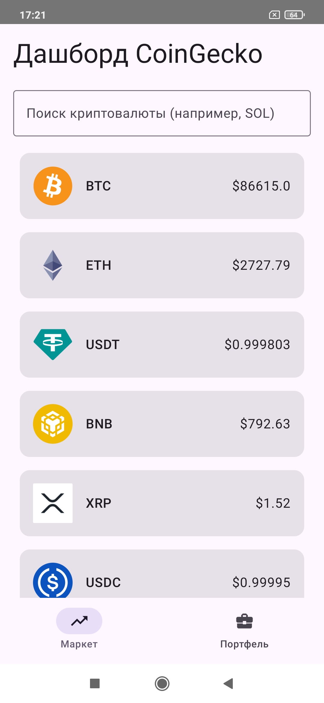
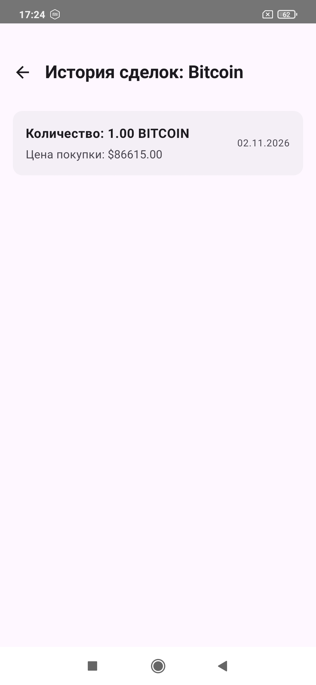
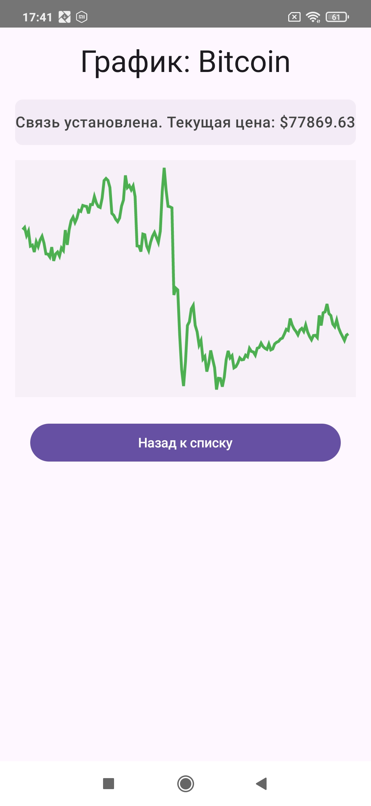
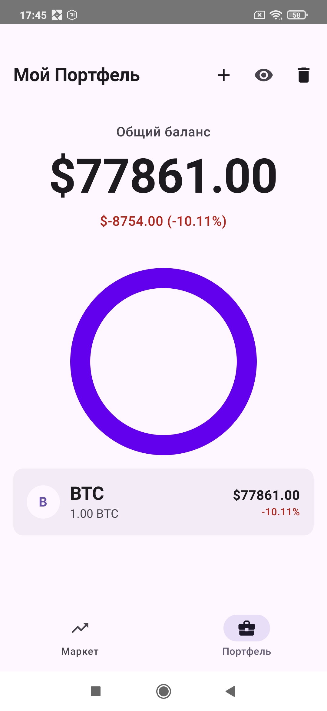

# CryptoTracker

**CryptoTracker** — Android-приложение для отслеживания курсов криптовалют и управления личным криптопортфелем. Проект разработан на Kotlin и Jetpack Compose с использованием многомодульной архитектуры.

Данные о криптовалютах загружаются из **CoinGecko API**. Приложение сочетает сетевые обновления с локальным кэшированием и отображает состояние подключения к интернету.

## Возможности

- **Курсы криптовалют:** просмотр актуальных котировок с обновлением данных при открытом экране.
- **Поиск:** фильтрация монет по запросу с `debounce` 300 мс.
- **Криптопортфель:** просмотр активов, общей стоимости портфеля, прибыли и убытка.
- **Операции с активами:** учёт транзакций и просмотр их истории.
- **Графики:** просмотр исторических данных о цене выбранной криптовалюты.
- **Работа при сетевых ошибках:** локальный кэш котировок, индикация устаревших данных и повторные запросы с экспоненциальной задержкой.

## Скриншоты приложения

| Dashboard | AssetDetails | CryptoGraph | Portfolio |
|:---:|:---:|:---:|:---:|
|  |  |  |  |

## Технологии

| Область | Технологии |
| --- | --- |
| Язык и UI | Kotlin, Jetpack Compose, Material 3 |
| Архитектура | Clean Architecture, MVI, многомодульная структура |
| Асинхронность | Coroutines, Flow, StateFlow |
| Внедрение зависимостей | Hilt |
| Сеть | Retrofit, OkHttp, Kotlinx Serialization, CoinGecko API |
| Локальные данные | Room, Proto DataStore, Google Tink |
| Навигация | Navigation Compose с типобезопасными маршрутами |
| Изображения и логи | Coil, Timber |
| Тестирование | JUnit, MockK, Coroutines Test, Turbine |
| CI | GitHub Actions, Gradle |

## Архитектура проекта

Проект разделён на feature-модули и общие core-модули. Модуль `:app` отвечает за точку входа, общую сборку приложения и навигацию.

| Модуль | Назначение |
| --- | --- |
| `:app` | Точка входа и навигация между экранами |
| `:feature:dashboard` | Список криптовалют и поиск |
| `:feature:portfolio` | Портфель, история операций, графики и детали активов |
| `:core:model` | Общие модели данных |
| `:core:domain` | Контракты репозиториев и UseCase |
| `:core:data` | Реализации репозиториев, работа с API и локальным хранилищем |
| `:core:network` | Общая логика повторных сетевых запросов |
| `:core:ui` | Переиспользуемые UI-модели и мапперы |
| `:core:designsystem` | Тема и компоненты оформления |
| `:core:common` | Общие утилиты и типобезопасные маршруты |

Код экранов размещается в feature-модулях; доменные контракты и реализации работы с данными отделены от UI.

## Технические особенности

- Автоматическое обновление котировок с интервалом **10 секунд**, когда экран активен.
- Повтор сетевых запросов при ошибках: **экспоненциальная задержка с jitter**.
- Реактивное получение локально сохранённых данных через **Flow**.
- Типобезопасная навигация между экранами через **Navigation Compose**.
- Хранение пользовательских настроек с использованием **Proto DataStore** и шифрования на основе **Google Tink**.

## Сборка и запуск

**Требования:** Android Studio, JDK 21, Android SDK для сборки проекта. Минимальная поддерживаемая версия Android — **API 26**.

1. Клонируйте репозиторий: `git clone https://github.com/Red-armyman/CryptoTracker.git`.
2. Откройте папку `CryptoTracker` в Android Studio и дождитесь синхронизации Gradle.
3. Запустите приложение на устройстве или эмуляторе с Android 8.0 (API 26) или новее.

Проверка сборки из корня проекта: `./gradlew build`.

## Тестирование и CI

Unit-тесты размещаются в соответствующих feature-модулях. Для тестирования используются **JUnit, MockK, Coroutines Test и Turbine**.

В репозитории настроен **GitHub Actions**: при создании или обновлении Pull Request в `master`, а также после изменений в `master`, автоматически запускается задача `./gradlew build` на **JDK 21**. Для ветки `master` настроены правила защиты и обязательное успешное прохождение проверки перед слиянием.

---

*Учебный пет-проект для практики современной Android-разработки и демонстрации архитектурных и инженерных решений.*